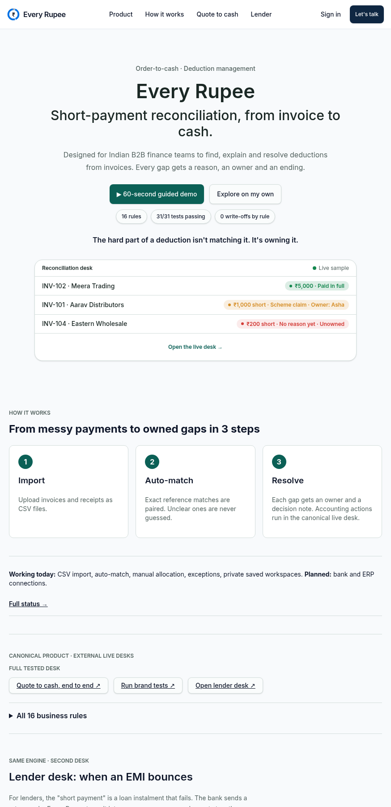

# Every Rupee

**Short-payment reconciliation from invoice to cash. Every gap gets a reason, an owner, and an ending—never a guess.**

[](https://every-rupee-gets-owner.lovable.app/)
[](https://everyrupee-o2c.vercel.app/)
[](src/lib/reconciliation/engine.test.ts)
[](https://everyrupee-o2c.vercel.app/desk.html?uat=1)

Built by **Rupak Ghanpathi** ([Portfolio](https://rupak-lemon.vercel.app) · [LinkedIn](https://www.linkedin.com/in/rupak-ghanpathi) · `rupakr2g@gmail.com`) — Business Analyst (2.5 yrs at HDFC Bank across retail lending, agri-finance, maker-checker controls, and SOX audit support).



---

## Why This Exists

In Indian B2B distribution, a single short-paid invoice is rarely one problem—it is usually **statutory tax withheld (TDS u/s 194Q)**, a **commercial scheme or damage claim**, and an **unexplained gap** bundled into one bank transfer.

- **The public signal:** In Cello World Ltd’s FY25–FY26 filings, trade receivables grew **+14.0%** (₹658 Cr → ₹750 Cr) while revenue grew **+8.8%** (₹2,136 Cr → ₹2,324 Cr)—roughly **₹34 Cr** above revenue-pace growth *(an external estimate that justifies discovery, not a diagnosis of internal backlog)*.
- **The distributor reality:** FMCG distributors operate on thin margins (**₹3.5–5 per ₹100**, AICPDF Jun 2026) and manual claim settlement often takes **45–90 days** (Spirestock). Rather than wait, distributors deduct claims at payment.
- **The tax deadline nobody owns:** Settling a scheme claim via a **GST credit note u/s 34(2)** recovers the GST already paid on the discount—but only if issued by **30 November** following the financial year (30 Nov 2026 for FY25–26 supplies). Undecided deductions silently lose that tax recovery window.

**Every Rupee** replaces inbox threads and spreadsheet guesswork with a deterministic reconciliation desk: **0 write-offs by rule**, **maker-checker enforcement above ₹10,000**, and a **SHA-256 hash-chained history** on every case.

---

## Live Surfaces

| Surface | URL | What You Can Do |
| :--- | :--- | :--- |
| **Interactive Product App** *(this repo)* | [`every-rupee-gets-owner.lovable.app`](https://every-rupee-gets-owner.lovable.app/) | Guided 60-second tour, live **Receivables Desk** (`/demo`), **Lender NACH Bounce Desk** (`/lender-demo`), tamper-evident SHA-256 history verifier, and private saved workspaces (`/workspace`). |
| **Receivables Desk (`/demo`)** | [`/demo`](https://every-rupee-gets-owner.lovable.app/demo) | Four sample invoices (Billed **₹1,91,300** · Received **₹1,73,710** · Gap **₹17,590**). Run auto-match, verify Ten Today sales approvals, test maker-checker blocks, and inspect the tamper-evident audit chain. |
| **Lender EMI Bounce Desk (`/lender-demo`)** | [`/lender-demo`](https://every-rupee-gets-owner.lovable.app/lender-demo) | Same engine applied to bounced loan instalments: parses NACH return codes (`04`, `61`, `06`), routes to Collections / Ops / Relationship, and enforces RBI Aug 2023 penal-charge rules. |
| **Quote-to-Cash Route** | [`everyrupee-o2c.vercel.app`](https://everyrupee-o2c.vercel.app/) | Follow one discount end-to-end from a sales rep’s request in **Ten Today** (`APV-2026-031`) to closed books in **Every Rupee**. |
| **Full Executable Specification** | [`everyrupee-o2c.vercel.app/desk.html`](https://everyrupee-o2c.vercel.app/desk.html) | All 16 business rules (`BR-1`–`BR-11`, `LR-1`–`LR-5`), 31 in-browser UAT tests, BRD, and Jira/CSV exports. |

---

## Core Architecture & Engineering Guarantees

### 1. Deterministic Money & Shared Validation (`src/lib/reconciliation/engine.ts`)
- **Integer paise everywhere:** Every invoice, receipt, allocation, and cap is stored and computed in integer paise (`₹1,91,300.00` = `19130000`). Floating-point rounding errors cannot occur.
- **No over-allocation:** Client and server run the exact same `validateWorkspace` invariants. Allocating `1 paisa` above an invoice or receipt balance throws immediately.
- **Atomic CSV imports:** Malformed rows or duplicate IDs reject the entire batch cleanly without partial state mutation.

### 2. Governance & Separation of Duties (`BR-4`, `BR-5`, `BR-8`, `BR-10`)
- **`BR-4` (Zero automated write-offs):** No rule or case resolution can silently write money off or mutate underlying cash/invoice balances.
- **`BR-5` (Maker-checker above ₹10,000):** Gaps up to ₹10,000 (`1000000` paise) can be resolved by the assigned analyst with a note. Above ₹10,000, the maker must submit for review (`pending_approval`) and is **blocked from self-approving**—a separate controller (`Vikram`) must approve or send back.
- **Role-bound ownership & Sales handback:** A case can only be assigned to an owner who handles that reason class. When a gap is routed to Sales (`Rahul`) for an unapproved scheme promise, Finance (`Asha`) is blocked from closing it until the rep records their action and hands it back.
- **`BR-10` (Cross-system handoff contract v1 with Ten Today):** Reads base64url-encoded approval tokens from [Ten Today](https://tentoday.vercel.app/), validates schema version, range (`1%–40%`), non-self-approval (`rep !== approver`), and SHA-256 payload seal (`checkTenTodaySeal`), then splits deductions at `capBeforeGst + 18% GST`.

### 3. 3-Layer Tamper-Evident SHA-256 Audit Chain & Controller Anchor (`sealLog`, `inspectLogChain`, `verifyLogWithAnchor`)
Every case action (`at`, `who`, `text`) is sealed into a linked SHA-256 chain starting from `'GENESIS'`:
```text
hash[i] = SHA-256( JSON.stringify({ invoiceId, at, who, text, prevHash }) )
```
- **Layer 1 — Payload Integrity:** Recomputes the SHA-256 digest of each canonical JSON record (`{invoiceId, at, who, text, prevHash}`) and flags raw database text/amount edits (`storedHash !== recomputedHash`) plus downstream cascade invalidation.
- **Layer 2 — Chain Link Integrity:** Verifies `entry[k].prevHash === entry[k-1].hash` from `GENESIS`, catching deleted or reordered middle rows.
- **Layer 3 — Pinned Controller Anchor Root (`verifyLogWithAnchor`):** Pins the 64-hex chain head when the Finance Controller seals/approves a case. Even if a privileged attacker edits a historical row **and** runs `forceResealLog` to recompute every SHA-256 hash across the table, the head hash diverges from the pinned Controller Anchor (`anchor_mismatch`).

### 4. Quantified Operational Outcomes (Public CPG Benchmarks + 25-Bill Batch Preset)
In the live demo desk, switch between the **4-bill starter sample** (`₹1.91L`) and the **25-bill regional distributor batch** (`₹68.4L` across 10 distributors, calibrated to **Cello World FY24–FY25 Annual Report AR disclosures** and **APQC / The Hackett Group CPG O2C benchmarks**):
- **Detection Latency:** `7–14 days` manual bank-to-ERP lag $\rightarrow$ **`Day 0 (< 5 ms)`** at UTR import.
- **Manual 4-Way Check Effort:** `22 min / bill` manual lookup across UTR, ERP invoice, scheme circular, and credit-note ledger $\rightarrow$ **`< 2 min / bill`** (`19 / 25` bills auto-triaged, saving **~6.3 hours** of analyst lookup per batch).
- **Dispute Resolution Cycle:** `30–45 days` CPG industry median $\rightarrow$ **`3–7 day` role-locked owner SLA**, preventing disputed tails from crossing into the >180-day Ind AS Expected Credit Loss (ECL) provision bucket.
- **Silent Leakage Blocked:** Automatically flags expired scheme approvals (`APV-2026-035`) and over-cap deductions (`APV-2026-038`), enforcing `₹0` write-offs by rule (`BR-4`) and dual-control above `₹10,000` (`BR-5`).

### 5. Second Domain, Same Engine: Lender NACH Bounce Desk (`src/lib/reconciliation/lender-codes.ts`)
Proves the core state machine generalizes from FMCG receivables to retail/MSME lending:
- Maps NACH return codes (`04` Insufficient balance, `61` Mandate cancelled, `06` Payment stopped by drawer) to deterministic owners, SLAs, and allowed outcomes.
- Enforces **RBI’s August 2023 Fair Lending Practice on Penal Charges** (`LR-3`): penal charges are levied as standalone charges, never capitalized into principal, and never compounded with fresh interest.
- AI explanations are strictly constrained: they may reword the rule in plain language, but can never invent a reason code or execute an action without human confirmation.

---

## Test Suite (`30 / 30` Passing in Vitest)

Run the unit and contract test suite locally:

```bash
npx vitest run
```

| Test Group | Assertions Covered |
| :--- | :--- |
| **Reconciliation Invariants** (`engine.test.ts`) | Exact reference matching, suspense holding for unreferenced receipts, partial allocations, ambiguous-reference rejection, idempotent double-match, atomic CSV validation, decimal-to-paise parsing. |
| **Governance & Controls** (`BR-4`, `BR-5`, `BR-10`) | Write-off rejection (`BR-4`), ₹10,000 boundary check (`BR-5`), maker self-approval block, checker send-back and approval, sales handback lock, Ten Today GST-inclusive cap split (`BR-10`). |
| **Handoff & Cryptography** (`Ten Today v1` + `SHA-256`) | Rejects corrupted, wrong-version, self-approved, or >40% tokens; verifies SHA-256 payload seal; detects edited, reordered, or deleted audit log entries at the exact broken index. |
| **Routing & UI Wiring** (`app-routing.test.tsx`) | Verified route mounting and navigation across landing, demo desk, lender desk, and capabilities. |

---

## Repository Structure

```text
src/
├── lib/reconciliation/
│   ├── engine.ts            # Pure TypeScript rules engine (matching, BR-4/5/10, Ten Today contract, SHA-256 chain)
│   ├── engine.test.ts       # 26 deterministic unit & cryptographic verification tests
│   ├── lender-codes.ts      # NACH return-code rules, owners, SLAs, and RBI penal-charge guardrails
│   ├── functions.ts         # Server functions for workspace persistence & demo requests
│   └── lender.functions.ts  # Constrained plain-language explanation handler
├── components/reconciliation/
│   ├── workspace.tsx        # Receivables reconciliation desk UI, CSV import, & live tamper-check editor
│   ├── lender-desk.tsx      # NACH EMI bounce queue & resolution workflow
│   ├── case-dialog.tsx      # Maker-checker modal, Ten Today approval verifier, & hash-chain inspector
│   └── tour.tsx             # 60-second interactive guided walkthrough
├── routes/
│   ├── index.tsx            # Product overview, live sample preview, 16-rule matrix, & traceability chain
│   ├── demo.tsx             # Public interactive Receivables Desk
│   ├── lender-demo.tsx      # Public interactive Lender NACH Desk
│   ├── capabilities.tsx     # Honest status ledger (working today vs. planned integrations)
│   └── _authenticated/      # Private user workspaces backed by Postgres + RLS
└── drizzle/
    └── schema.ts            # Postgres schema for saved workspaces and demo requests
```

---

## Local Development

```bash
# 1. Install dependencies
npm install

# 2. Start the development server (TanStack Start + Vite)
npm run dev

# 3. Run the deterministic engine & routing tests
npx vitest run
```

---

## Related Portfolio Artifacts by Rupak Ghanpathi

1. **[Every Rupee — Canonical Spec & Case Study](https://everyrupee-o2c.vercel.app/)** (`RUPAK30/Cello-O2C-Deduction-Workflow-Case-Study`) — Full BRD, 16 rules, 31 browser-run UAT cases, and Jira CSV exports.
2. **[Ten Today — B2B Sales Execution Module](https://tentoday.vercel.app/)** — Caps field sales reps at 10 ranked daily actions, enforces discount approval freezes, and issues the sealed `APV` tokens verified by Every Rupee.
3. **[Viraam — 2½-Minute Standup Close](https://lull-hr.vercel.app/)** — Calendar-anchored team meeting close with aggregate-only Friday reporting and 100 automated tests.

---

*Independent portfolio product built with synthetic sample data · Not affiliated with Cello World Ltd or any brand named in samples · Statutory tax rules (Income Tax s.194Q, CGST s.34(2), RBI Fair Lending guidelines) are summarised from public sources as of Oct 2026 for workflow design illustration and do not constitute tax or legal advice.*
